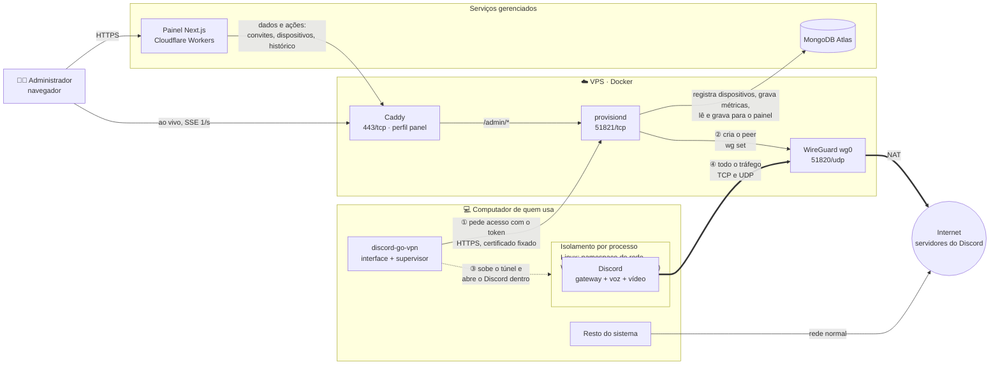
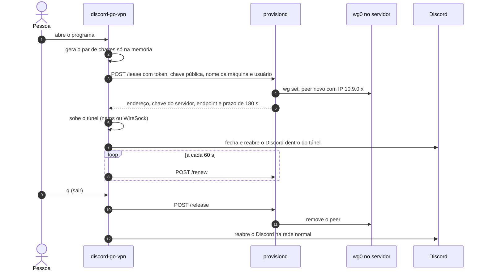

# discord-go-vpn

Abre o Discord dentro de um túnel WireGuard **sem modificar o cliente** e sem
instalar uma VPN para o sistema todo.

Só o Discord passa pelo túnel. O resto do computador — navegador, jogos,
downloads — continua na rede normal. No celular, o app Android faz o mesmo.

```
╭──────────────────────────────────────────────────────╮
│  ●  conectado                                        │
│                                                      │
│  perfil     acesso do servidor                       │
│  discord    dentro do túnel                          │
│  há         12min 00s                                │
╰──────────────────────────────────────────────────────╯

  q sair
```

## Sumário

- [Visão geral](#visão-geral)
- [Arquitetura](#arquitetura)
- [Começando](#começando)
- [Linux e Windows](#linux-e-windows)
- [Android](#android)
- [Compilando](#compilando)
- [Atualização automática](#atualização-automática)
- [Quando o Windows acusa o executável](#quando-o-windows-acusa-o-executável)
- [Decisões de projeto](#decisões-de-projeto)
- [Estrutura do repositório](#estrutura-do-repositório)
- [Limites conhecidos](#limites-conhecidos)
- [Outras documentações](#outras-documentações)

## Visão geral

O projeto tem três partes, e o cliente tem uma versão para Android:

| Parte | Onde roda | O que faz |
|---|---|---|
| **Cliente** (`cmd/discord-go-vpn`) | no computador de quem usa | sobe o túnel, põe o Discord dentro dele e mostra o estado na tela |
| **App Android** (`android/`, `mobile/`) | no celular de quem usa | o mesmo cliente, com a VPN do Android restrita ao app do Discord |
| **Servidor** (`server/`, `cmd/provisiond`) | numa VPS | o WireGuard e o `provisiond`, que entrega acessos temporários a quem roda o cliente |
| **Painel** (`panel/`) | Cloudflare Workers + MongoDB Atlas | onde o administrador vê quem está conectado e derruba acessos, e gera os convites que viram tokens de conexão |

Só o cliente é obrigatório. Com um arquivo `.conf` de qualquer provedor
WireGuard ele funciona sozinho; o servidor e o painel existem para distribuir
acesso a outras pessoas sem mandar arquivo nenhum.

## Arquitetura



**Lendo o diagrama:**

1. O cliente gera um par de chaves **na memória** e pede um acesso ao
   `provisiond` indicado no token de conexão, apresentando o convite que vem
   dentro dele, o nome da máquina e o usuário do sistema.
2. O `provisiond` confere o acesso, registra a máquina no MongoDB e registra a
   chave pública como um peer da `wg0`, com um endereço só dele.
3. O cliente sobe o túnel e **fecha e reabre o Discord dentro dele**. No Linux
   o Discord nasce num namespace de rede cuja única saída é o túnel; no Windows
   um filtro WFP captura os processos do Discord e só eles.
4. Todo o tráfego do Discord — o gateway (TCP) e a mídia da chamada (UDP) — sai
   pela VPS. O resto do computador não é tocado.

O painel fica ao lado, sem entrar no caminho do túnel: o `provisiond` grava
métricas no Atlas e transmite o estado ao vivo direto para o navegador do
administrador, passando pelo Caddy, que dá o certificado válido. O painel não
conecta no Atlas: convites, dispositivos e histórico também passam pelo
`provisiond`. Detalhes em
[`server/`](server/README.md) e [`panel/`](panel/README.md).

### Uma sessão, do começo ao fim



Se o programa for fechado de forma abrupta (queda de energia, `kill -9`), o
acesso morre sozinho: sem renovação, o servidor remove o peer em até cerca de
3 minutos e meio.

## Começando

### Recebi um token de conexão

O programa não traz servidor nenhum: quem administra o servidor cria um convite
no painel e te manda um **token de conexão**, uma linha que começa com `dgv1_`
e carrega o endereço do servidor, a impressão digital do certificado dele e o
convite.

- **Linux:** `sudo ./discord-go-vpn`
- **Windows:** duplo clique no `.exe` e aceite o aviso de administrador.

Na primeira vez, o programa **pede o token no terminal**:

```
Cole o token de conexão que você recebeu (começa com dgv1_):
> dgv1_eyJzZXJ2ZXIiOi…
```

Colou, e pronto: nas próximas vezes o programa entra direto. No Windows, cole o
token na janela que abre depois do aviso de administrador.

O token fica guardado no diretório de configuração de quem executa o programa:
`%AppData%\discord-go-vpn\token` no Windows e `~/.config/discord-go-vpn/token`
no Linux (com `sudo`, normalmente o do root). Não há `.conf` nem chave privada
para guardar: as chaves são geradas a cada execução e descartadas ao sair. No
painel, a máquina aparece pelo nome do computador e pelo usuário do sistema que
abriu o programa.

Para trocar de token, rode uma vez com `-token dgv1_…` — o novo substitui o
guardado. Se o servidor não responder, o token continua guardado e o programa
tenta de novo.

Se o convite for revogado, o programa avisa e pede outro token — na partida, no
terminal, e também na tela do túnel, sem precisar fechar nada: aparece um campo
para colar o token novo, que vale na tentativa seguinte. O mesmo campo aparece
quando o servidor do token não responde a várias tentativas seguidas, caso de um
token com o endereço errado. Revogar atinge
todas as máquinas que entraram pelo mesmo convite, de uma vez: um convite
**individual** é de uma pessoa, um **global** é compartilhado por várias.

### Tenho um arquivo `.conf`

Sem servidor de acesso, vale qualquer perfil WireGuard: ProtonVPN (o tier gratuito
funciona), Mullvad ou um servidor seu; veja [`example.conf`](example.conf) para o
formato.

Deixe o `.conf` na mesma pasta do programa e rode sem argumentos:

```sh
make                 # ou: go build -o discord-go-vpn ./cmd/discord-go-vpn
sudo ./discord-go-vpn
```

O programa procura perfis na pasta do executável e na pasta atual e usa o mais
recente. Para indicar um arquivo específico, use `-c /caminho/arquivo.conf`.

> Um `.conf` na pasta **tem prioridade**: se existir, o túnel sobe com ele e o
> programa não pede token.

### Opções

| Opção | O que faz |
|---|---|
| `-c arquivo.conf` | usa este perfil em vez de procurar na pasta |
| `-token dgv1_…` | passa o token de conexão sem a pergunta (também: variável `VPN_TOKEN`) |
| `-discord caminho` | aponta o executável do Discord, se ele estiver fora do lugar comum |

Se o terminal não consegue desenhar a interface, o programa segue em modo texto,
uma linha por mudança de estado.

### Na tela

| Tecla | O que faz |
|---|---|
| `q` / `Esc` / `Ctrl+C` | sai, desfaz o túnel e devolve o Discord à rede normal |
| `r` | reconecta agora, sem esperar (só aparece quando há o que apressar) |

### Quando a conexão cai

O supervisor tenta reconectar sozinho, esperando de 3 s a 30 s entre as
tentativas. Depois de **3 falhas seguidas**, ele devolve o Discord à rede normal
(estado *sem túnel*), para a pessoa não ficar com um cliente morto, e continua
tentando em segundo plano. Quando o túnel volta, o Discord é posto de novo
dentro dele.

Uma renovação do acesso que falha aparece na tela como o último erro. O
supervisor trata como queda e reconecta, seguindo as mesmas regras, quando o
acesso acabou: o servidor responde que ele expirou (acesso desconectado pelo
painel, por exemplo) ou as renovações falham por todo o prazo de 3 minutos (como
depois de revogar o convite).

## Linux e Windows

O modo é escolhido pelo sistema.

| | Linux | Windows |
|---|---|---|
| **Modo** | `netns` | `wiresock` |
| **Mecanismo** | o Discord roda num namespace de rede cuja única saída é o túnel | o WireSock instala um filtro WFP no kernel que captura só os processos do Discord |
| **Privilégio** | `root` (`sudo`) | administrador (o `.exe` já pede, pelo UAC) |
| **Dependências** | `iproute2` (comando `ip`) | WireSock, instalado sozinho pelo `winget` na primeira execução |

Fora do Linux e do Windows não há modo: capturar um processo inteiro depende de
um mecanismo do sistema operacional. O programa diz isso e para, em vez de subir
um túnel por onde o Discord não passaria. No Android esse mecanismo existe, e o
app próprio o usa (abaixo).

### Particularidades do Windows

- **Duplo clique basta.** O `.exe` traz um manifest que pede elevação, então o
  UAC aparece antes de qualquer janela. Aceite, e ele instala o WireSock se
  faltar, sobe o túnel e abre o Discord.
- **A janela espera um Enter antes de fechar**, para dar tempo de ler uma
  mensagem de erro.
- **Ícone na bandeja:** o tooltip mostra se o túnel está de pé.
- O Discord é aberto direto pelo `Discord.exe` da versão mais recente, sem
  passar pelo `Update.exe` — essa execução não busca atualização.

## Android

O app (`android/`) usa a VPN do Android com o Discord como único app permitido:
o sistema põe no túnel tudo o que o Discord abre, voz e vídeo inclusive, e
nada mais. Por baixo roda o mesmo código Go do cliente desktop — token de
conexão, acesso temporário, supervisor e reconexão —, empacotado com o
`gomobile` a partir de `mobile/`. Os estados e as mensagens são os mesmos da
tela do desktop, e o visual segue o do painel.

Como instalar, usar e compilar: [`android/README.md`](android/README.md).

## Compilando

```sh
make          # binário para este sistema
make dist     # Linux amd64 + Windows amd64/arm64, com SHA256SUMS (VERSION=v1.2.3 numa versão publicada)
make test     # gofmt + go vet (Linux e Windows) + testes
make lint     # golangci-lint (Linux e Windows), configurado em .golangci.yml
make android  # APK do app Android em dist/ (precisa do Android SDK e do NDK)
```

O CI (`.github/workflows/ci.yml`) roda `make test`, `make lint`, `make android`
(o APK fica como artefato do job) e o lint, typecheck, Prettier, Vitest e build
do painel em todo pull request e em todo push no `main`.

Para compilar para Windows a partir de outro sistema sem o Makefile:

```sh
GOOS=windows GOARCH=amd64 CGO_ENABLED=0 \
  go build -trimpath -ldflags "-buildid=" -o discord-go-vpn.exe ./cmd/discord-go-vpn
```

O binário não embute servidor, token nem impressão digital: o mesmo executável
serve para qualquer servidor, e o acesso vem do token de conexão (ou de um
`.conf`).

O build é **reproduzível** (`-trimpath` e `-buildid=`): o mesmo código gera
sempre o mesmo binário, e qualquer um pode conferir o hash.

Outros alvos: `make syso` regera os recursos do Windows (manifest, metadados e
ícone), `make icon` regera o `.ico` a partir do favicon do painel
(`panel/app/icon.svg`, precisa de ImageMagick) e
`make provisiond` compila o servidor para linux/amd64.

## Atualização automática

Ao abrir, antes de levantar o túnel, o cliente de Linux e Windows procura a
versão mais nova nas [Releases](https://github.com/bumaruf/discord-go-vpn/releases)
deste repositório. Achando uma maior que a sua, baixa o binário da sua
plataforma, troca o próprio executável e se reabre com os mesmos argumentos.
Como isso acontece antes de conectar, uma atualização nunca derruba uma chamada.
Se o GitHub não responder em 10 s, ou se algo falhar, o cliente avisa numa linha
e segue com a versão atual. `-no-update` pula a verificação.

**Por que dá para confiar.** Cada release traz um `update.json`, com a versão e
o SHA-256 de cada binário, e o `update.json.sig`, a assinatura ed25519 dele. O
cliente só aceita um manifesto assinado pela chave pública que ele mesmo traz
embutida (`publicKey` em `internal/update/update.go`), só instala um binário cujo
tamanho e hash batem com o manifesto, e só sobe de versão, nunca desce. Então
quem tomar a conta do GitHub ou a release não consegue mandar um binário para os
clientes: para isso precisaria da chave privada, que existe só como secret do CI.

- **Linux:** o arquivo novo substitui o antigo com um `rename`, e o processo se
  troca pelo novo via `exec`, mantendo o `sudo` e o terminal.
- **Windows:** um `.exe` em execução não pode ser sobrescrito, mas pode ser
  renomeado: o antigo vira `discord-go-vpn.exe.old`, que a próxima abertura
  apaga. A versão nova roda como processo filho na mesma janela.
- **Android:** fica de fora por enquanto; o APK continua vindo do CI.

Um binário compilado sem `VERSION` (o `make` comum, ou `go build`) nunca se
atualiza.

### Publicando uma versão

Uma vez só, para criar a chave:

```sh
go run ./cmd/updatesign keygen
```

A linha `private` vira o secret `UPDATE_SIGNING_KEY` do repositório (Settings →
Secrets and variables → Actions) e não é guardada em mais lugar nenhum. A linha
`public` vai para `publicKey` em `internal/update/update.go`, num commit. Trocar
a chave depois exige que todo mundo baixe à mão um binário com a chave nova.

Depois, a cada versão, basta uma tag:

```sh
git tag v1.2.3 && git push origin v1.2.3
```

O workflow `.github/workflows/release.yml` roda `make test`, compila com
`make dist VERSION=v1.2.3`, assina com `make sign` e publica a release com os
binários, o `SHA256SUMS`, o `update.json` e a assinatura. O `make sign` falha se o
secret não corresponder à `publicKey` do código, para nunca publicar uma versão
que os clientes recusariam.

## Quando o Windows acusa o executável

O SmartScreen avisa na primeira execução e o Defender pode marcar o arquivo como
`Trojan:Win32/Wacatac.B!ml`. O sufixo `!ml` indica um **classificador
estatístico**, não uma assinatura de vírus conhecido.

O que ele vê é um executável **sem assinatura digital** que pede administrador,
encerra processos (`taskkill /F`), instala software pelo `winget`, levanta um
filtro de rede no kernel e grava uma chave privada num arquivo temporário. Cada
item tem um motivo neste README; juntos, num binário que pouca gente baixou,
disparam a heurística.

**Não desligue o antivírus nem crie uma exclusão às cegas.** Confira o arquivo:

```powershell
Get-FileHash .\discord-go-vpn.exe -Algorithm SHA256
```

O resultado tem de bater com a linha do `SHA256SUMS` publicado junto do binário.
Batendo, é falso positivo — vale reportar pelo formulário *Submit a file for
analysis* da Microsoft. A solução definitiva é assinar o executável com um
certificado de code signing; até lá, hash publicado e build reproduzível são a
alternativa honesta.

## Decisões de projeto

<details>
<summary><b>Por que o acesso é temporário e as chaves são efêmeras</b></summary>

No WireGuard uma chave é **um peer com um endereço**: duas máquinas com o mesmo
perfil se derrubam. Por isso cada execução gera o próprio par de chaves e pede um
endereço só dela. No Linux a chave privada fica só na memória; no Windows ela
passa por um arquivo temporário, legível só pelo dono, que o WireSock lê. O
acesso tem prazo curto e é renovado enquanto o programa roda — se ele morrer sem avisar, o
acesso morre junto.

</details>

## Estrutura do repositório

```
android/               o app Android (Kotlin, Jetpack Compose)
build/                 manifest, ícone e metadados do .exe (viram rsrc_windows_*.syso)
cmd/discord-go-vpn/    o cliente: opções e escolha do perfil
cmd/provisiond/        o servidor de acessos: flags e a ligação dos pacotes de internal/provisiond/
cmd/updatesign/        cria a chave de atualização e assina o update.json de uma release
internal/app/          liga as peças e controla o ciclo de vida (TUI, modo texto, bandeja)
internal/contracttest/ confere os formatos de rede de testdata/contracts/ contra os tipos Go
internal/discord/      encontra, fecha e reabre o cliente do Discord
internal/errtext/      traduz para pt-BR os erros mostrados a quem usa
internal/connectiontoken/ lê, pede, valida e guarda o token de conexão
internal/platform/     console, elevação e bandeja do Windows
internal/profile/      de onde vem a configuração: .conf local ou acesso do servidor
internal/provisiond/   o servidor de acessos por dentro: leases, convites, métricas, stream e ações do painel
internal/routing/      os modos de rota (netns, wiresock)
internal/supervisor/   mantém o túnel de pé, reconecta e faz o fallback
internal/statustext/   os nomes dos estados e os textos que a tela, a bandeja e o app Android mostram
internal/transport/    põe o Discord no túnel: netns no Linux, WireSock no Windows, VpnService no Android
internal/ui/           a interface de texto
internal/update/       a atualização automática: confere o manifesto assinado, troca o executável e reabre
internal/wg/           lê o .conf
mobile/                a API Go que o gomobile empacota para o app Android
panel/                 painel de administração (Next.js num Cloudflare Worker)
server/                o que roda na VPS (Docker Compose, Caddy, scripts)
testdata/contracts/    os formatos de rede que o Go e o painel conferem
docs/                  glossário dos termos do domínio
```

## Limites conhecidos

- **A qualidade depende da saída.** IPs de VPN pública gratuita costumam ser
  compartilhados e saturados; um servidor próprio dá banda dedicada (veja
  [`server/`](server/README.md)).
- **Só Linux, Windows e Android.** Fora deles não há mecanismo para capturar um
  processo inteiro; no iPhone, a VPN por app só existe em aparelhos gerenciados
  por MDM.
- **Um Discord já aberto não é capturado.** Ele precisa nascer dentro do túnel,
  por isso o programa fecha e reabre o que estiver rodando.
- **Nada é feito no cliente.** O Discord roda sem modificação — o programa só
  escolhe por qual rede ele sai.

## Outras documentações

| Documento | Conteúdo |
|---|---|
| [`server/README.md`](server/README.md) | montar a VPS, subir o servidor, painel com Caddy, migração e referência de rotas e variáveis |
| [`panel/README.md`](panel/README.md) | rodar e publicar o painel de administração |
| [`android/README.md`](android/README.md) | instalar, usar e compilar o app Android |
| [`docs/glossary.md`](docs/glossary.md) | o nome em inglês de cada termo do domínio |

## Licença

GPL-3.0-or-later.
