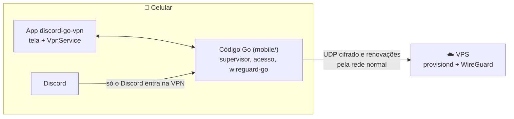

# App Android

O cliente do discord-go-vpn para Android. Ele põe **só o Discord** dentro do
túnel WireGuard; o resto do celular continua na rede normal.

## Sumário

- [Como funciona](#como-funciona)
- [Instalando](#instalando)
- [Usando](#usando)
- [Compilando](#compilando)
- [Estrutura](#estrutura)
- [Limites conhecidos](#limites-conhecidos)

## Como funciona

O Android deixa uma VPN valer só para alguns apps. O app cria a VPN com o
Discord (`com.discord`) como único app permitido, então tudo o que o Discord
abre — gateway, voz e vídeo — entra no túnel, e nada mais. É o equivalente do
namespace de rede no Linux e do filtro do WireSock no Windows.



Por baixo roda o mesmo código Go do cliente desktop, empacotado com o
`gomobile`:

- **Token de conexão:** o mesmo `dgv1_…` que o painel gera. O app valida o
  token pedindo um acesso de verdade, guarda o token se o servidor aceitar ou
  não responder, e apaga o token salvo se o servidor recusar.
- **Acesso temporário:** cada conexão gera um par de chaves novo e pede um
  endereço ao `provisiond`, renovado a cada 60 s e devolvido ao desconectar. No
  painel o celular aparece com o nome definido nas configurações do Android, ou
  com o modelo.
- **Supervisor:** o mesmo do desktop. Ele reconecta com intervalo crescente,
  de 3 s até 30 s, e depois de 3 falhas seguidas devolve o Discord à rede normal
  enquanto continua tentando.
- **`.conf`:** como no desktop, um arquivo `.conf` de qualquer servidor
  WireGuard substitui o token.

O código do app em si (`android/`) só desenha a tela e cuida da VPN do
Android; a lógica fica no Go.

## Instalando

1. Baixe o `discord-go-vpn.apk` da [release mais recente](https://github.com/bumaruf/discord-go-vpn/releases/latest),
   ou compile (abaixo).
2. Abra o arquivo no celular e permita a instalação de apps dessa origem quando
   o Android pedir.

O app precisa do Android 8 ou mais novo e do Discord instalado.

> Sem as variáveis de assinatura (abaixo), o APK sai assinado com a chave de
> depuração de quem compilou. Ele instala normalmente, mas não atualiza um APK
> assinado com outra chave: nesse caso, desinstale o anterior antes.

## Usando

1. **Cole o token de conexão** e toque em **Conectar**. Quem tem um servidor
   WireGuard próprio pode tocar em **Usar um arquivo .conf**.
2. Na primeira vez, o Android pede para **permitir a conexão VPN**, e no
   Android 13 ou mais novo também pede para mostrar notificações.
3. Quando a conexão sobe com o app na tela, **o Discord abre sozinho**.

| Estado | O que significa |
|---|---|
| **subindo** | pedindo o acesso, subindo o túnel e esperando o servidor responder |
| **conectado** | o Discord está dentro do túnel |
| **reconectando** | a conexão caiu e o app está tentando de novo; **Tentar agora** pula a espera |
| **sem túnel** | 3 falhas seguidas: o Discord voltou para a rede normal enquanto o app continua tentando |
| **parado** | desconectado; **Conectar** usa o token ou o `.conf` salvo |

Se o servidor recusar o token ou parar de responder, a tela pede um token novo,
como a tela do desktop.

**Notificação:** enquanto o túnel roda, uma notificação fixa mostra o estado e
traz os botões **Tentar agora** e **Desconectar**.

**Bloco rápido:** o bloco **Discord VPN**, que você adiciona nas configurações
rápidas, liga e desliga o túnel sem abrir o app. Quando o Android exige a tela
(permissão de VPN, token faltando), o bloco abre o app.

**VPN sempre ativa:** dá para ativar o app em *Configurações › Rede › VPN* como
VPN sempre ativa; o Android então sobe o túnel sozinho.

## Compilando

Precisa de Go, do Android SDK com o NDK (`ANDROID_HOME` e `ANDROID_NDK_HOME`)
e do JDK 17 ou mais novo. Na raiz do repositório:

```sh
make android    # gera dist/discord-go-vpn.apk
```

O alvo compila o `gomobile` e o `gobind` nas versões fixadas no `go.mod`, gera
o `android/app/libs/mobile.aar` a partir de `mobile/` (arm64, arm e amd64, este
para o emulador) e roda o `./gradlew assembleRelease`.

Para assinar com uma chave própria, defina antes do build:

| Variável | O que é |
|---|---|
| `ANDROID_KEYSTORE` | caminho do keystore |
| `ANDROID_KEYSTORE_PASSWORD` | senha do keystore |
| `ANDROID_KEY_ALIAS` | alias da chave |
| `ANDROID_KEY_PASSWORD` | senha da chave |

Na release, o workflow lê as três senhas de secrets com esses mesmos nomes e o
keystore do secret `ANDROID_KEYSTORE_BASE64` (o arquivo em base64). Sem ele, o
APK da release sai com a chave de depuração do runner, que muda a cada build.

Para trabalhar no Android Studio, rode `make android` uma vez (gera o `.aar`) e
abra a pasta `android/`.

## Estrutura

```
android/app/src/main/java/io/github/bumaruf/discordgovpn/
  App.kt            inicializa o Go e o canal de notificação
  MainActivity.kt   pede as permissões e liga a tela ao serviço
  TunnelService.kt  a VpnService: cria a interface, roda a sessão Go, mostra a notificação
  TunnelTile.kt     o bloco rápido
  Tunnel.kt         o estado que a tela, o bloco e a notificação leem
  Profiles.kt       o .conf importado e o nome do aparelho
  ui/               tema (os tokens do painel), componentes e telas
mobile/             a API Go que o gomobile empacota
internal/transport/vpnservice/  o wireguard-go sobre a interface da VpnService
```

A fonte é a Geist, a mesma do painel, sob a SIL Open Font License
(`third_party/geist/LICENSE.TXT`).

## Limites conhecidos

- **Um Discord já aberto pode continuar fora do túnel.** No desktop o cliente
  fecha e reabre o Discord; no Android nenhum app pode fechar outro. As
  conexões que o Discord já tinha podem ficar na rede normal até ele
  reconectar. Por isso, com o túnel de pé, o app avisa para fechar o Discord
  pela lista de apps recentes e abrir de novo.
- **Durante a reconexão o Discord usa a rede normal.** Sem a interface da VPN,
  o Android manda o tráfego dele pela rede normal, como acontece no Windows
  enquanto o filtro do WireSock está fora do ar.
- **Só Android.** No iPhone, a VPN por app só existe em aparelhos gerenciados
  por MDM.
