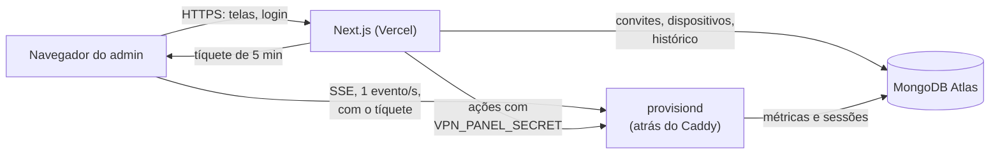

# Painel

Interface web de administração da VPN: gerar convites, ver quem está conectado,
desconectar máquinas e revogar acessos. **Next.js na Vercel, MongoDB no Atlas.**

- Arquitetura do projeto inteiro, com diagrama: [`../README.md`](../README.md#arquitetura)
- O lado do servidor (Caddy, secrets, rotas): [`../server/README.md`](../server/README.md)

## Sumário

- [O modelo](#o-modelo)
- [Como as peças se falam](#como-as-peças-se-falam)
- [Rodando localmente](#rodando-localmente)
- [Variáveis de ambiente](#variáveis-de-ambiente)
- [Publicando na Vercel](#publicando-na-vercel)
- [Estrutura](#estrutura)
- [O que sustenta o desenho](#o-que-sustenta-o-desenho)

## O modelo

**Quem usa a VPN recebe um token de conexão.** O executável é o mesmo para
qualquer servidor; o token traz o endereço do servidor e o acesso, e a pessoa
cola uma vez. Não há cadastro, senha nem conta para quem usa a VPN. **Só o administrador tem
login**, e é para isso que este painel existe.

**Cada máquina é o nome do computador mais o usuário do sistema** que roda o
Discord, e a lista mostra os dois (`notebook · ana`). O IP aparece na tela, mas
fica fora da identidade: o endereço do túnel muda a cada acesso e o IP público
muda quando a pessoa troca de rede.

**Todo acesso é um convite.** O admin gera o convite escolhendo o tipo —
**individual**, para uma pessoa, ou **global**, para ser usado por várias; a
diferença é só de organização — e o painel mostra, uma única vez, o **token de
conexão** `dgv1_…`. O token já leva o endereço do servidor, o fingerprint do
certificado e o acesso, então a pessoa só cola no programa quando ele pedir. A
lista de quem está usando se agrupa por convite.

**Desconectar ≠ revogar:**

| Ação | Alcance | Efeito |
|---|---|---|
| **Desconectar** | uma máquina | derruba o acesso atual; ela volta em segundos |
| **Revogar** | o convite inteiro | derruba todas as máquinas do convite e impede novas entradas |
| **Reativar** | o convite inteiro | libera o convite de novo (não reconecta ninguém sozinho) |
| **Excluir** | o convite inteiro | revoga e apaga o convite; o histórico das máquinas continua, como "Convite removido". Não tem volta |

## Como as peças se falam



**O banco não fica no caminho do tempo real.** O `provisiond` transmite direto
para o navegador; o Atlas guarda o que precisa sobreviver a um restart.

Quando o stream cai, a tela **não finge estar ao vivo**:

- após 3 falhas seguidas, os números passam a vir de `/api/live`, que lê o
  banco, enquanto o stream tenta voltar (espera de até 10 s);
- o cabeçalho troca "ao vivo" por "sem conexão ao vivo";
- o gráfico de throughput mostra "indisponível" em vez de uma curva inventada.

## Rodando localmente

Precisa de um MongoDB. Para desenvolver, um container serve:

```sh
docker run -d --name mongo-painel -p 27017:27017 mongo:8
```

```sh
cp .env.example .env.local     # e preencha
npm install
npm run hash-password -- "sua senha"   # gera o ADMIN_PASSWORD_HASH para colar no .env
npm run setup                  # cria coleções e índices (idempotente)
npm run dev
```

Uma vez, em produção, para juntar o histórico que a saída do token global partiu (idempotente):

```sh
npm run merge-devices
```

Ele soma no dispositivo atual o consumo diário do antigo, de `inviteId` nulo, repõe o `deviceId`
das sessões, leva o primeiro acesso junto e apaga o antigo. Não mescla o dispositivo que casa com
mais de um convite: imprime quais são, para o dono decidir. As `samples` ficam de fora, porque
expiram em 48 h.

Antes de abrir um PR:

```sh
npm run lint                   # ESLint, falha com qualquer aviso
npm run typecheck              # tsc --noEmit
npm run format:check           # Prettier (npm run format corrige)
npm test                       # Vitest; os testes ficam ao lado do arquivo, em *.test.ts
npm run build
```

Três armadilhas que custam uma tarde:

- **O login não passa pelo banco.** A conta de admin é fixa e vem do ambiente
  (`ADMIN_USERNAME` + `ADMIN_PASSWORD_HASH`). Com o Atlas fora do ar você ainda
  entra e ainda vê o stream ao vivo — só o histórico fica indisponível.
  As tentativas erradas, sim, são contadas no banco: 10 falhas do mesmo IP
  bloqueiam o login dele por 15 min (coleção `login_attempts`, com o índice TTL
  do `npm run setup`). Com o banco fora, a contagem para e o login segue livre.
- **O hash sai em base64 de propósito.** O Next expande `$VAR` dentro de
  arquivos `.env`, e um hash argon2 é cheio de `$`. Colado cru, ele chega
  mutilado e o sintoma é só "senha incorreta" — e apenas na sua máquina, porque
  na Vercel o valor é injetado direto.
- **`AUTH_TRUST_HOST=true` é obrigatório fora da Vercel.** Sem ele toda rota de
  autenticação responde 500, com um erro que não diz o que fazer.

## Variáveis de ambiente

O [`.env.example`](.env.example) tem os comentários completos.

| Variável | Obrigatória | Para quê |
|---|---|---|
| `ADMIN_USERNAME` | sim | usuário do login |
| `ADMIN_PASSWORD_HASH` | sim* | hash da senha (`npm run hash-password`) |
| `ADMIN_PASSWORD` | não | alternativa em texto claro — evite |
| `AUTH_SECRET` | sim | assina a sessão (`openssl rand -base64 32`) |
| `AUTH_TRUST_HOST` | fora da Vercel | `true` |
| `NEXTAUTH_URL` | sim | URL pública do painel |
| `MONGODB_URI`, `MONGODB_DB` | sim | o banco (padrão do nome: `vpn`) |
| `PROVISIOND_URL` | sim | `https://` + o `PANEL_DOMAIN` do servidor |
| `VPN_PANEL_SECRET` | sim | autoriza as ações — **mesmo valor** do servidor |
| `VPN_LIVE_SECRET` | sim | assina os tíquetes do stream — **mesmo valor** do servidor |
| `PROVISIOND_LEASE_URL` | sim | endereço que os clientes usam para pedir acesso, `https://<ip-da-vps>:51821` (não é o `PROVISIOND_URL`); vai dentro do token de conexão |
| `PROVISIOND_FINGERPRINT` | sim | fingerprint do certificado que o `provisiond` imprime no log ao subir; vai dentro do token de conexão. Sem ele ou sem o `PROVISIOND_LEASE_URL`, gerar convite falha |
| `MONTHLY_QUOTA_GB` | não | desenha a barra de progresso do consumo do mês |
| `NEXT_PUBLIC_SERVER_NAME` | não | nome no cabeçalho e no login (padrão `wg0`) |
| `NEXT_PUBLIC_WG_PORT` | não | porta exibida na visão geral (padrão `51820/udp`) |

\* `ADMIN_PASSWORD_HASH` ou `ADMIN_PASSWORD`.

Uma variável vazia ou só com espaços conta como ausente e cai no padrão.

Sem as variáveis, o app **builda e não funciona** — a falha só aparece em
runtime.

## Publicando na Vercel

Em produção, o projeto é o **`vpn-painel`** (time `bumaruf-projects`), ligado a
este repositório com **Root Directory `panel`** e branch de produção `main`.
O `ignoreCommand` do [`vercel.json`](vercel.json) pula o build quando nada em
`panel/` mudou desde o último deploy bem-sucedido da branch; sem esse deploy de
referência (primeiro push da branch, histórico raso), o build roda.

Para montar um deploy novo:

1. **Root Directory `panel`** nas configurações do projeto.
2. **As variáveis de ambiente** da tabela acima.
3. **Um domínio próprio.** Com *Vercel Authentication* ligada, o domínio
   `*.vercel.app` pede login de uma conta do time; o domínio próprio abre
   normalmente e as URLs de preview seguem protegidas.
4. **`0.0.0.0/0` no Network Access do Atlas.** A Vercel não tem IP de saída
   fixo no plano hobby — a senha do usuário do banco passa a ser a única
   barreira. Use um usuário do banco só para o painel, separado do servidor.
5. **No servidor:** `PANEL_ORIGIN` com a URL deste painel (CORS do stream) e as
   duas secrets com os mesmos valores. Veja [`../server/README.md`](../server/README.md#painel-perfil-panel).

## Estrutura

Nomes de arquivo em inglês e em kebab-case (`device-list.tsx`, `use-live.ts`).

```
app/
  login/                  login do administrador
  dashboard/              visão geral (KPIs, throughput, 30 dias)
    header.tsx            cabeçalho único: servidor, status ao vivo, conta e as abas
    routes.ts             as páginas do painel, lidas pela navegação e pelos títulos
    peers/                quem está usando: toda máquina cadastrada, conectada ou não, agrupada por convite, e o detalhe dela
    invites/              gerar, copiar, revogar, reativar e excluir
  api/auth/               rotas do Auth.js
  api/ticket/             emite o tíquete curto do stream
  api/live/               o que o banco sabe, quando o stream não está de pé
  api/usage/              consumo diário de uma máquina
components/
  live-provider.tsx       provider do stream, compartilhado por cabeçalho e telas
  charts/                 Throughput (ao vivo) e DailyBars (30 dias), em Recharts
  ui/                     componentes do shadcn/ui e os do painel (PageHeader, StatusDot, TrafficPair)
hooks/
  use-live.ts             SSE, fallback e backoff atrás de uma interface só
lib/
  env.ts                  toda leitura de env var e seus padrões
  api-response.ts         as respostas JSON das rotas do painel
  admin.ts                a conta fixa do painel, `server-only`
  require-admin.ts        confere a sessão de admin (401 sem sessão, 403 sem papel)
  action-result.ts        o tipo de retorno das Server Actions
  toast-result.ts         mostra o resultado de uma Server Action num toast
  utils.ts                `cn`, que junta classes do Tailwind (usado pelos componentes do shadcn)
  mongo-names.ts          nomes de coleção, campo e valor gravado no Mongo, num lugar só
  mongodb.ts              conexão com cache global (obrigatório em serverless)
  invites.ts, devices.ts, repositórios: páginas, rotas e ações leem e gravam o Mongo
  sessions.ts, samples.ts só por eles
  audit.ts                grava a auditoria das ações
  provisiond.ts           o único lugar que conhece a secret de escrita
  provisiond-url.ts       monta as URLs do provisiond a partir de `PROVISIOND_URL`
  ticket.ts               assina o tíquete do stream (o Go confere)
  token.ts                gera o código do convite e o hash que o provisiond reconhece
  connection-token.ts     monta o token de conexão `dgv1_…` que o cliente decodifica
  usage.ts                repositório do histórico de consumo (diário e do mês)
  merge-devices.ts        junta o consumo das máquinas que a saída do token global partiu em duas
  usage-days.ts           `USAGE_DAYS`, a janela do gráfico diário, importável do navegador
  live-snapshot.ts        formato do stream
  live-stream.ts          lê os eventos do stream
  live-fallback.ts        monta o peer do fallback a partir de uma sessão do banco
  indexes.ts              coleções e índices, usados pelo `npm run setup`
scripts/
  hash-password.ts        `npm run hash-password`
  setup.ts                `npm run setup`
  merge-devices.ts        `npm run merge-devices`
auth.ts, auth.config.ts   Auth.js (Credentials + sessão JWT; a duração vem de `lib/session-max-age.ts`)
proxy.ts                  protege a navegação de /dashboard
```

## O que sustenta o desenho

**O token de conexão aparece uma vez.** O banco guarda só o hash do convite
que vai dentro dele — quem ler o banco não entra no túnel. Perder o token custa
gerar outro convite.

**Nem a secret de escrita nem a senha do admin chegam ao navegador.**
`lib/provisiond.ts`, `lib/admin.ts` e `lib/mongodb.ts` começam com
`import 'server-only'`: se um componente de cliente os importar por engano, o
build quebra.

**Proxy é roteamento, não autorização.** O `proxy.ts` decide o que a navegação
mostra. As Server Actions, as rotas de API do painel e o layout de `/dashboard`
revalidam a sessão com `requireAdmin()`, porque é a Server Action que segura a
secret.

**Revogar acontece no servidor primeiro.** O painel chama o `provisiond`, que
derruba os acessos e só então grava "revogado" no banco. Na ordem inversa, uma
falha de rede faria a tela dizer que o grupo está fora enquanto ele continua
trafegando. Excluir segue a mesma regra: revoga no servidor e só então apaga o
convite.

**Toda ação fica registrada** na coleção `audit_log`: criar, revogar, reativar e
excluir convite, e desconectar máquina.
