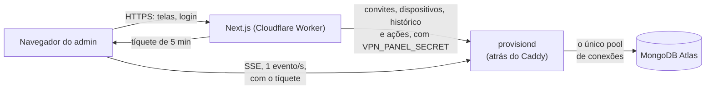

# Painel

Interface web de administração da VPN: gerar convites, ver quem está conectado,
desconectar máquinas e revogar acessos. **Next.js num Cloudflare Worker (OpenNext),
MongoDB no Atlas.**

- Arquitetura do projeto inteiro, com diagrama: [`../README.md`](../README.md#arquitetura)
- O lado do servidor (Caddy, secrets, rotas): [`../server/README.md`](../server/README.md)

## Sumário

- [O modelo](#o-modelo)
- [Como as peças se falam](#como-as-peças-se-falam)
- [Rodando localmente](#rodando-localmente)
- [Variáveis de ambiente](#variáveis-de-ambiente)
- [Publicando na Cloudflare](#publicando-na-cloudflare)
- [Estrutura](#estrutura)
- [O que sustenta o desenho](#o-que-sustenta-o-desenho)

## O modelo

**Quem usa a VPN recebe um token de conexão.** O executável é o mesmo para
qualquer servidor; o token traz o endereço do servidor e o acesso, e a pessoa
cola uma vez. Não há cadastro, senha nem conta para quem usa a VPN. **Só o administrador tem
login**, e é para isso que este painel existe.

**Cada máquina é o nome do computador mais o usuário do sistema** que roda o
Discord, e a lista mostra os dois (`notebook · ana`). O IP aparece na tela, mas
fica fora da identidade: o endereço do túnel muda a cada acesso e o IP público
muda quando a pessoa troca de rede.

**Todo acesso é um convite.** O admin gera o convite escolhendo o tipo —
**individual**, para uma pessoa, ou **global**, para ser usado por várias; a
diferença é só de organização — e o painel mostra, uma única vez, o **token de
conexão** `dgv1_…`. O token já leva o endereço do servidor, o fingerprint do
certificado e o acesso, então a pessoa só cola no programa quando ele pedir. A
lista de quem está usando se agrupa por convite.

**Desconectar ≠ revogar:**

| Ação | Alcance | Efeito |
|---|---|---|
| **Desconectar** | uma máquina | derruba o acesso atual; ela volta em segundos |
| **Revogar** | o convite inteiro | derruba todas as máquinas do convite e impede novas entradas |
| **Reativar** | o convite inteiro | libera o convite de novo (não reconecta ninguém sozinho) |
| **Excluir** | o convite inteiro | revoga e apaga o convite; o histórico das máquinas continua, como "Convite removido". Não tem volta |

## Como as peças se falam



**O painel não conecta no banco.** Tudo o que ele lê ou grava no Atlas passa
pelas rotas `/admin/*` do `provisiond`
([`../server/README.md`](../server/README.md#rotas-do-provisiond)), que mantém
o único pool de conexões, perto do banco. Um Worker não guarda conexões entre
requests: abrir uma a cada página custaria o handshake TLS + autenticação do
Atlas toda vez, e um Durable Object não roda na América do Sul, longe do
cluster em São Paulo. Cada página faz uma chamada só, e o consumo diário tem
cache de 30 s no `provisiond`.

**O banco não fica no caminho do tempo real.** O `provisiond` transmite direto
para o navegador; o Atlas guarda o que precisa sobreviver a um restart.

Quando o stream cai, a tela **não finge estar ao vivo**: depois de 3 falhas
seguidas o cabeçalho troca "ao vivo" por "sem conexão ao vivo", a tela mantém
o último retrato e o gráfico de throughput mostra "indisponível", enquanto o
stream tenta voltar (espera de até 10 s). Não há fallback pelo banco: os dados
dele também vêm do `provisiond`, que é quem estaria fora.

## Rodando localmente

Os dados vêm de um `provisiond` (`PROVISIOND_URL` + `VPN_PANEL_SECRET`): o de
produção, ou um local apontado para um Mongo de desenvolvimento. Os scripts
(`setup`, `merge-devices`) falam com o banco direto, por `MONGODB_URI`; para
desenvolver, um container serve:

```sh
docker run -d --name mongo-painel -p 27017:27017 mongo:8
```

```sh
cp .env.example .env.local     # e preencha
npm install
npm run hash-password -- "sua senha"   # gera o ADMIN_PASSWORD_HASH para colar no .env
npm run setup                  # cria coleções e índices (idempotente)
npm run dev
```

Para juntar os dispositivos repetidos da mesma máquina (idempotente):

```sh
npm run merge-devices -- --dry-run   # só mostra o que juntaria
npm run merge-devices
npm run setup                        # troca o índice único pelo que ignora maiúsculas
```

Uma máquina é o nome do computador mais o usuário do sistema, sem diferenciar maiúsculas, em
qualquer convite. O dispositivo visto por último fica: recebe o consumo diário dos outros, o
`deviceId` das sessões e o primeiro acesso, e os outros são apagados. Um dispositivo sem usuário do
sistema entra na máquina do único usuário com aquele nome; se houver mais de um, o script só o
lista, para o dono decidir. Máquinas sem nome nunca são juntadas. As `samples` ficam de fora, porque
expiram em 48 h. O `setup` falha, sem mexer no índice antigo, enquanto houver dispositivos que só
diferem em maiúsculas.

Antes de abrir um PR:

```sh
npm run lint                   # ESLint, falha com qualquer aviso
npm run typecheck              # tsc --noEmit, depois de gerar os tipos da Cloudflare (cf-typegen)
npm run format:check           # Prettier (npm run format corrige)
npm test                       # Vitest; os testes ficam ao lado do arquivo, em *.test.ts
npm run build
```

Para rodar no runtime da Cloudflare (workerd) em vez do Node, com as variáveis
num `.dev.vars` (mesmo formato do `.env.local`, ignorado pelo git):

```sh
npm run preview                # build do OpenNext + wrangler dev em http://localhost:8787
```

Três armadilhas que custam uma tarde:

- **O login não passa pelo banco.** A conta de admin é fixa e vem do ambiente
  (`ADMIN_USERNAME` + `ADMIN_PASSWORD_HASH`). Com o Atlas ou o `provisiond`
  fora do ar você ainda entra; só os dados ficam indisponíveis.
  As tentativas erradas são contadas no Workers KV `LOGIN_ATTEMPTS`: 10 falhas
  do mesmo IP bloqueiam o login dele por 15 min. Com o KV fora, a contagem para
  e o login segue livre.
- **O hash sai em base64 de propósito.** O Next expande `$VAR` dentro de
  arquivos `.env`, e um hash argon2 é cheio de `$`. Colado cru, ele chega
  mutilado e o sintoma é só "senha incorreta" — e apenas na sua máquina, porque
  na Cloudflare o valor é injetado direto.
- **`AUTH_TRUST_HOST=true` é obrigatório**, também na Cloudflare (o Auth.js só
  detecta a Vercel sozinho). Sem ele toda rota de autenticação responde 500, com
  um erro que não diz o que fazer.
- **No `npm run preview`, o `/dashboard` volta para o login** mesmo logado:
  sem `X-Forwarded-Proto`, o proxy do Auth.js supõe `https` e procura o cookie
  `__Secure-…`, que um login em `http` não grava. Em produção a Cloudflare manda
  o header; localmente, teste com `curl -H "X-Forwarded-Proto: http"`.

## Variáveis de ambiente

O [`.env.example`](.env.example) tem os comentários completos.

| Variável | Obrigatória | Para quê |
|---|---|---|
| `ADMIN_USERNAME` | sim | usuário do login |
| `ADMIN_PASSWORD_HASH` | sim* | hash da senha (`npm run hash-password`) |
| `ADMIN_PASSWORD` | não | alternativa em texto claro — evite |
| `AUTH_SECRET` | sim | assina a sessão (`openssl rand -base64 32`) |
| `AUTH_TRUST_HOST` | sim | `true` |
| `NEXTAUTH_URL` | sim | URL pública do painel |
| `MONGODB_URI`, `MONGODB_DB` | só nos scripts | o banco de `npm run setup` e `merge-devices` (padrão do nome: `vpn`); o Worker não usa |
| `PROVISIOND_URL` | sim | `https://` + o `PANEL_DOMAIN` do servidor |
| `VPN_PANEL_SECRET` | sim | autoriza as ações — **mesmo valor** do servidor |
| `VPN_LIVE_SECRET` | sim | assina os tíquetes do stream — **mesmo valor** do servidor |
| `PROVISIOND_LEASE_URL` | sim | endereço que os clientes usam para pedir acesso, `https://<ip-da-vps>:51821` (não é o `PROVISIOND_URL`); vai dentro do token de conexão |
| `PROVISIOND_FINGERPRINT` | sim | fingerprint do certificado que o `provisiond` imprime no log ao subir; vai dentro do token de conexão. Sem ele ou sem o `PROVISIOND_LEASE_URL`, gerar convite falha |
| `MONTHLY_QUOTA_GB` | não | desenha a barra de progresso do consumo do mês |
| `NEXT_PUBLIC_SERVER_NAME` | não | nome no cabeçalho e no login (padrão `wg0`) |
| `NEXT_PUBLIC_WG_PORT` | não | porta exibida na visão geral (padrão `51820/udp`) |

\* `ADMIN_PASSWORD_HASH` ou `ADMIN_PASSWORD`.

Uma variável vazia ou só com espaços conta como ausente e cai no padrão.

Sem as variáveis, o app **builda e não funciona** — a falha só aparece em
runtime.

## Publicando na Cloudflare

Em produção, o painel é o Worker **`discord-go-vpn-panel`** da conta pessoal
`bumaruf`, construído pelo [`@opennextjs/cloudflare`](https://opennext.js.org/cloudflare)
e configurado em [`wrangler.jsonc`](wrangler.jsonc). Precisa do **Workers Paid**:
o argon2 do login gasta ~150 ms de CPU, e o plano free para em 10 ms.

A CI publica sozinha ([`deploy-panel.yml`](../.github/workflows/deploy-panel.yml)),
sempre depois do job `Panel` passar e só quando `panel/` mudou:

- **Pull request:** um Workers Preview `pr-<n>`, com a URL comentada no PR.
  Fechar o PR apaga o Preview. Previews são **públicos** (o login do painel
  continua valendo); para fechá-los, ponha o Cloudflare Access na frente.
- **Push na `main`:** deploy de produção.

### Montando do zero

1. **Token da API** (dash.cloudflare.com → *My Profile* → *API Tokens*), com o
   template *Edit Cloudflare Workers*: a conta inteira (inclui *Workers KV
   Storage: Edit*, que o binding `LOGIN_ATTEMPTS` exige) e, se for usar domínio
   próprio, *Workers Routes: Edit* na zona. Sem filtro de IP (os runners do
   GitHub mudam de IP). O de produção se chama
   `github-actions-discord-go-vpn-panel`.
2. **O namespace KV** `LOGIN_ATTEMPTS`: `npx wrangler kv namespace create
   LOGIN_ATTEMPTS`, com o id em `wrangler.jsonc` (produção e `previews`).
3. **Secrets do repositório:** `CLOUDFLARE_ACCOUNT_ID` e `CLOUDFLARE_API_TOKEN`.
   **Variáveis do repositório** (*Settings → Secrets and variables → Variables*):
   `NEXT_PUBLIC_SERVER_NAME` e `NEXT_PUBLIC_WG_PORT`, se usadas. O build embute
   as `NEXT_PUBLIC_*` no JavaScript do navegador, então elas vêm do build, não
   do Worker.
4. **Primeiro deploy**, que cria o Worker (os Previews da CI falham até ele
   existir). Sem `wrangler login`: o wrangler lê `CLOUDFLARE_ACCOUNT_ID` e
   `CLOUDFLARE_API_TOKEN` do `.env.local` do painel e os prefere ao login
   OAuth. Confira a conta com `npx wrangler whoami`, rode `npm run deploy` e
   tire as duas linhas do arquivo.
5. **Secrets do Worker**, as variáveis da tabela acima sem as `NEXT_PUBLIC_*` e
   sem `MONGODB_*`, que o Worker não usa: `npx wrangler secret bulk arquivo.json`
   (ou `secret put NOME`, num terminal interativo: pelo `!` do Claude Code o
   wrangler lê o valor vazio e grava o secret em branco) para produção, e
   `npx wrangler preview base-config secret put NOME` para os Previews, que
   não herdam os de produção. `NEXTAUTH_URL` é a URL pública do painel.
6. **Domínio próprio:** com a zona ativa na conta, descomente `routes` no
   `wrangler.jsonc` (`custom_domain: true`). O deploy da CI troca os registros
   DNS conflitantes pelo Worker; não apague os antigos antes.
7. **No servidor:** `PANEL_ORIGIN` com a URL deste painel (CORS do stream) e as
   duas secrets com os mesmos valores. Veja [`../server/README.md`](../server/README.md#painel-perfil-panel).

Enquanto a Vercel ainda servir o domínio, o [`vercel.json`](vercel.json)
continua valendo: ele pula o build da Vercel quando nada em `panel/` mudou. Some
junto com o projeto `vpn-painel`, depois do corte do domínio.

## Estrutura

Nomes de arquivo em inglês e em kebab-case (`device-list.tsx`, `use-live.ts`).

```
app/
  login/                  login do administrador
  dashboard/              visão geral (KPIs, throughput, 30 dias)
    header.tsx            cabeçalho único: servidor, status ao vivo, conta e as abas
    routes.ts             as páginas do painel, lidas pela navegação e pelos títulos
    peers/                quem está usando: toda máquina cadastrada, conectada ou não, agrupada por convite, e o detalhe dela
    invites/              gerar, copiar, revogar, reativar e excluir
  api/auth/               rotas do Auth.js
  api/ticket/             emite o tíquete curto do stream
  api/usage/              consumo diário de uma máquina
components/
  live-provider.tsx       provider do stream, compartilhado por cabeçalho e telas
  charts/                 Throughput (ao vivo) e DailyBars (30 dias), em Recharts
  ui/                     componentes do shadcn/ui e os do painel (PageHeader, StatusDot, TrafficPair)
hooks/
  use-live.ts             SSE, fallback e backoff atrás de uma interface só
lib/
  env.ts                  toda leitura de env var e seus padrões
  api-response.ts         as respostas JSON das rotas do painel
  admin.ts                a conta fixa do painel, `server-only`
  require-admin.ts        confere a sessão de admin (401 sem sessão, 403 sem papel)
  action-result.ts        o tipo de retorno das Server Actions
  toast-result.ts         mostra o resultado de uma Server Action num toast
  utils.ts                `cn`, que junta classes do Tailwind (usado pelos componentes do shadcn)
  mongo-names.ts          nomes de coleção, campo e valor gravado no Mongo, usados pelos scripts
  documents.ts            os documentos gravados, como os scripts os leem
  password.ts             argon2id em JS puro (o Worker não carrega módulo nativo)
  invites.ts, devices.ts  repositórios: páginas, rotas e ações leem e gravam os dados só
                          por eles, que chamam as rotas de dados do provisiond
  audit.ts                grava a auditoria das ações
  login-attempts.ts       conta as falhas de login por IP no Workers KV
  provisiond.ts           o único lugar que conhece a secret do painel e fala com o provisiond
  provisiond-url.ts       monta as URLs do provisiond a partir de `PROVISIOND_URL`
  ticket.ts               assina o tíquete do stream (o Go confere)
  token.ts                gera o código do convite e o hash que o provisiond reconhece
  connection-token.ts     monta o token de conexão `dgv1_…` que o cliente decodifica
  usage.ts                repositório do histórico de consumo (diário e do mês)
  merge-devices.ts        junta os dispositivos repetidos de uma máquina, com o consumo
  usage-days.ts           `USAGE_DAYS`, a janela do gráfico diário, importável do navegador
  live-snapshot.ts        formato do stream
  live-stream.ts          lê os eventos do stream
  indexes.ts              coleções e índices, usados pelo `npm run setup`
scripts/
  hash-password.ts        `npm run hash-password`
  setup.ts                `npm run setup`
  merge-devices.ts        `npm run merge-devices`
auth.ts, auth.config.ts   Auth.js (Credentials + sessão JWT; a duração vem de `lib/session-max-age.ts`)
proxy.ts                  protege a navegação de /dashboard
wrangler.jsonc            o Worker e seus bindings
open-next.config.ts       cache do OpenNext (páginas estáticas dos assets, sem R2/KV)
```

## O que sustenta o desenho

**O token de conexão aparece uma vez.** O banco guarda só o hash do convite
que vai dentro dele — quem ler o banco não entra no túnel. Perder o token custa
gerar outro convite.

**Nem a secret de escrita nem a senha do admin chegam ao navegador.**
`lib/provisiond.ts` e `lib/admin.ts` começam com
`import 'server-only'`: se um componente de cliente os importar por engano, o
build quebra.

**Proxy é roteamento, não autorização.** O `proxy.ts` decide o que a navegação
mostra. As Server Actions, as rotas de API do painel e o layout de `/dashboard`
revalidam a sessão com `requireAdmin()`, porque é a Server Action que segura a
secret.

**Revogar acontece no servidor primeiro.** O painel chama o `provisiond`, que
derruba os acessos e só então grava "revogado" no banco. Na ordem inversa, uma
falha de rede faria a tela dizer que o grupo está fora enquanto ele continua
trafegando. Excluir segue a mesma regra: revoga no servidor e só então apaga o
convite.

**Toda ação fica registrada** na coleção `audit_log`: criar, revogar, reativar e
excluir convite, e desconectar máquina.
