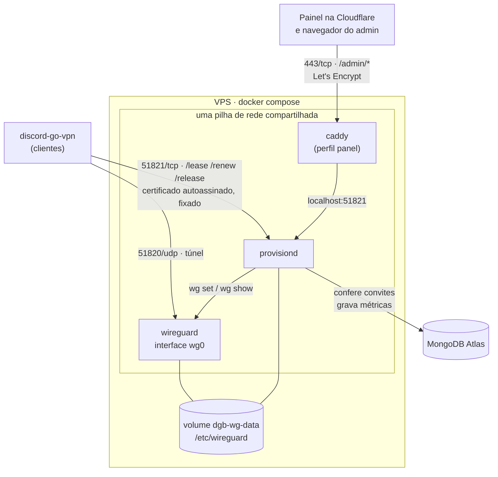

# Servidor

O que roda na VPS: o **WireGuard** e o **`provisiond`**, que entrega acessos
temporários a quem roda o cliente. Opcionalmente, o **Caddy**, que dá certificado
válido para o painel.

**Por que um servidor próprio:** os IPs de VPN pública gratuita são
compartilhados por muita gente e vivem saturados. Um servidor seu tem um IP e
uma banda só seus.

## Sumário

- [Visão geral](#visão-geral)
- [Passo a passo](#passo-a-passo)
  1. [Escolha a região](#1-escolha-a-região)
  2. [Crie a VPS](#2-crie-a-vps)
  3. [Suba o servidor](#3-suba-o-servidor)
  4. [Libere as portas](#4-libere-as-portas)
  5. [Distribua o acesso](#5-distribua-o-acesso)
  6. [Confira](#6-confira)
- [Painel (perfil `panel`)](#painel-perfil-panel)
- [Migrando um servidor que já está no ar](#migrando-um-servidor-que-já-está-no-ar)
- [Deploy contínuo](#deploy-contínuo)
- [Referência](#referência)
- [Por que é assim](#por-que-é-assim)

## Visão geral



- **`wireguard`** levanta a `wg0` e o NAT para a internet.
- **`provisiond`** roda com `network_mode: "service:wireguard"`: compartilha a
  pilha de rede do vizinho e enxerga a **mesma** `wg0`, que manipula com
  `wg set`. Por isso todas as portas são publicadas no serviço `wireguard`.
- **`caddy`** (só com `--profile panel`) repassa `/admin/*` para o
  `provisiond`. As rotas dos clientes não passam por ele.
- **O volume `dgb-wg-data`** guarda chaves, secrets e certificado. **Apagá-lo
  invalida todos os tokens de conexão já distribuídos**, que fixam a impressão
  digital do certificado — é o único comando destrutivo por aqui.

## Passo a passo

### 1. Escolha a região

Escolha pela latência — ela vai direto para a qualidade da transmissão.

| Região | Latência a partir de SP | Onde |
|---|---|---|
| Santiago / Valparaíso (CL) | ~40 ms | Oracle (free tier), Vultr |
| Bogotá (CO) | ~90 ms | Oracle (free tier) |
| Miami (EUA) | ~120 ms | Vultr, DigitalOcean |
| México | ~148 ms | *medido no perfil que testamos* |
| Europa | ~200 ms | Hetzner |

> **Oracle:** a *home region* é definida no cadastro e **não pode ser
> alterada**, e o Always Free só existe nela. Se a conta ficou com outra região, é
> preciso outra conta (Santiago ou Bogotá) ou uma VPS paga em outro provedor.

### 2. Crie a VPS

Na Oracle Cloud (free tier):

- **Shape:** `VM.Standard.A1.Flex` (ARM) — o mais generoso do free tier. Sem
  capacidade, `VM.Standard.E2.1.Micro` (x86) serve; um túnel WireGuard não
  precisa de força.
- **Imagem:** Ubuntu 22.04 ou 24.04.
- **Guarde a chave SSH** oferecida no fim — é o único acesso à máquina.

O free tier inclui 10 TB de saída por mês, muito mais do que uma transmissão
consome.

### 3. Suba o servidor

> **Servidor já no ar, com clientes usando?** Pare aqui e veja
> [Migrando um servidor que já está no ar](#migrando-um-servidor-que-já-está-no-ar).
> Subir o compose direto gera credenciais novas e invalida os tokens de conexão já distribuídos.

```sh
# na sua máquina
ssh ubuntu@SEU_IP mkdir -p discord-go-vpn
scp -r server go.mod go.sum cmd internal ubuntu@SEU_IP:~/discord-go-vpn/

# no servidor
ssh ubuntu@SEU_IP
curl -fsSL https://get.docker.com | sudo sh

cd ~/discord-go-vpn/server
sudo docker compose up -d --build
sudo docker compose logs provisiond     # a impressão digital do certificado sai aqui
```

O servidor precisa de Docker e de mais nada — nem Go, nem WireGuard instalado. O
`provisiond` é compilado dentro da imagem, na arquitetura da VPS (funciona em
ARM).

Antes de subir, crie o `server/.env` com o `MONGODB_URI` — veja o
[`.env.example`](.env.example). É no Mongo que ficam os convites que dão acesso:
sem ele, ou com o banco inacessível na partida, o `provisiond` encerra, e o
Compose tenta de novo. Na primeira subida o container gera o que falta e
**preserva no volume** (lista completa em [Arquivos no volume](#arquivos-no-volume)).

> As portas 80 e 443 são publicadas mesmo sem o perfil `panel`. Se algo no host
> já usa essas portas, o `docker compose up` falha.

### 4. Libere as portas

| Porta | Para quê | Quando |
|---|---|---|
| **51820/udp** | o túnel | sempre |
| **51821/tcp** | clientes pedirem acesso | sempre |
| **80/tcp e 443/tcp** | Caddy e Let's Encrypt | só com o painel |

Na Oracle há **duas barreiras**, e o sintoma das duas é o mesmo: o handshake
nunca acontece, sem mensagem de erro.

**1. A Security List da VCN** (console web):

> Networking → Virtual Cloud Networks → sua VCN → Security Lists → Default
> Security List → **Add Ingress Rule** — Source `0.0.0.0/0`, uma regra para
> cada porta da tabela acima, com o protocolo certo (UDP ou TCP).

**2. O iptables da imagem.** A imagem Ubuntu da Oracle tem um `REJECT` no fim
das cadeias `INPUT` e `FORWARD`. O Docker costuma inserir as próprias regras
acima dele, mas se o handshake não acontecer, confira com
`sudo iptables -L FORWARD -n --line-numbers` e libere à mão:

```sh
sudo iptables -I INPUT 1 -p udp --dport 51820 -j ACCEPT
sudo iptables -I INPUT 1 -p tcp --dport 51821 -j ACCEPT
# com o painel:
sudo iptables -I INPUT 1 -p tcp --dport 80  -j ACCEPT
sudo iptables -I INPUT 1 -p tcp --dport 443 -j ACCEPT
```

### 5. Distribua o acesso

O cliente não embute nada: o mesmo executável serve para qualquer servidor.
Quem usa recebe um **token de conexão** (`dgv1_…`), que o
[painel](#painel-perfil-panel) gera ao criar um convite e mostra uma única vez.
O token leva o endereço que os clientes discam para pedir acesso
(`https://SEU_IP:51821`, o `PROVISIOND_LEASE_URL` do painel), a impressão digital
do certificado que sai no log do passo 3 (o `PROVISIOND_FINGERPRINT`) e o
convite. Um convite **individual** é de uma pessoa; um **global** é
compartilhado por várias. A diferença é só de organização, e revogar um convite
derruba todas as máquinas que entraram por ele.

### 6. Confira

```sh
sudo docker compose exec wireguard wg show
```

Um cliente conectado aparece com `latest handshake` recente. Se ele nunca
aparecer, o problema é uma das [duas barreiras da Oracle](#4-libere-as-portas).

## Painel (perfil `panel`)

O painel na Cloudflare e o navegador do admin precisam de um certificado que uma
autoridade conheça, e o do `provisiond` é [autoassinado](#por-que-é-assim). O
Caddy resolve isso sem tocar no certificado que os clientes fixam.

**1. DNS:** crie um registro A de um subdomínio (ex.: `vpn-api.seudominio.com`)
para o IP da VPS, e libere 80/443 ([passo 4](#4-libere-as-portas)).

**2. `server/.env`:**

```sh
PANEL_DOMAIN=vpn-api.seudominio.com
PANEL_ORIGIN=https://painel.seudominio.com    # a URL do painel, para o CORS
MONGODB_URI=mongodb+srv://...                  # usuário do Atlas só do servidor
VPN_LIVE_SECRET=...                            # openssl rand -base64 32
# VPN_PANEL_SECRET vazio: é gerada e guardada no volume
```

**3. Suba com o perfil:**

```sh
sudo docker compose --profile panel up -d
```

**4. Leve os valores para os secrets do Worker do painel.** Os dois lados precisam do **mesmo valor**:

| No painel (Cloudflare) | Vem de |
|---|---|
| `PROVISIOND_URL` | `https://` + `PANEL_DOMAIN` |
| `PROVISIOND_LEASE_URL` | `https://SEU_IP:51821`, o endereço que vai dentro do token de conexão |
| `PROVISIOND_FINGERPRINT` | a impressão digital que sai em `sudo docker compose logs provisiond` |
| `VPN_PANEL_SECRET` | `sudo docker compose exec provisiond cat /etc/wireguard/panel-actions.token` (num volume antigo, veja [Arquivos no volume](#arquivos-no-volume)) |
| `VPN_LIVE_SECRET` | o valor que você definiu no `.env` |

O Caddy expõe só `/admin/*`, sem buffer (o stream precisa disso); qualquer outro
caminho responde 404.

> **O Mongo não é só métrica.** É nele que o `provisiond` confere os convites e
> registra as máquinas, por isso o `MONGODB_URI` é obrigatório. Com o Atlas fora
> do ar depois da partida, um convite que está no cache continua entrando; os
> outros recebem `503` até o banco voltar a responder, sem esperar o cache. O
> `503` não apaga o token guardado no cliente; um `401` apagaria, e por isso o
> `provisiond` não sobe sem o banco.

## Migrando um servidor que já está no ar

Os tokens de conexão distribuídos fixam a impressão digital do certificado, que
mora em arquivos no servidor; um volume vazio faria o container gerar um
certificado novo e inutilizar esses tokens de forma permanente.

Com a `wg0` já de pé no host (`wg-quick@wg0`), suba só o `provisiond` em
container, sem derrubar ninguém. Ele usa as credenciais de `/etc/wireguard`, e o
Caddy sobe junto, na rede do host:

```sh
sudo docker compose -f docker-compose.host.yml up -d
```

Pré-requisito: `/etc/wireguard` com as credenciais atuais. A VPS não precisa do
código-fonte: o compose roda a imagem publicada no GHCR para o commit em
`PROVISIOND_TAG` no `.env` (o [deploy contínuo](#deploy-contínuo) cuida disso);
sem `PROVISIOND_TAG`, roda a tag `latest` local, que `up --build` gera com o
código presente.

> Esse arquivo não traz `ENDPOINT` nem `PANEL_DOMAIN`: **defina os dois no
> `.env`**. Sem `ENDPOINT`, o IP público é descoberto na partida.

O `wg0.conf` do host não é gerado pelo `wg-up.sh`, então copie de lá o `PostUp`
e o `PostDown`, trocando `${NIC}` e `${BLOCKED_DESTINATIONS}` pelos valores. Sem
os `REJECT`, quem tem um convite alcança pelo túnel a rede privada da VPS, os
outros peers e o serviço de metadata da nuvem (`169.254.169.254`).

## Deploy contínuo

Vale para o servidor no modo acima (`docker-compose.host.yml`). Todo push na
`main` que muda o que entra na imagem do `provisiond` (`cmd/provisiond`,
`internal/provisiond`, `go.mod`, `go.sum` e os arquivos que o `Dockerfile`
copia de `server/`) dispara, depois de `make test` e `make lint` passarem, o
workflow [`deploy-server.yml`](../.github/workflows/deploy-server.yml):

1. constrói a imagem e publica em `ghcr.io/bumaruf/discord-go-vpn/provisiond:<sha>`;
2. entra por SSH na VPS com uma chave que só executa o [`deploy.sh`](deploy.sh);
3. o `deploy.sh` baixa a imagem, grava o commit em `PROVISIOND_TAG` no `.env`,
   recria o `provisiond` e espera o `GET /health` responder `200` por até ~1 min;
   se não responder, volta para a tag anterior e o workflow falha.

Recriar o `provisiond` não derruba ninguém: os acessos atravessam o restart
(veja [Tempos e limites](#tempos-e-limites)). Mudanças no
`docker-compose.host.yml`, no `Caddyfile` ou no próprio `deploy.sh` não passam
pela imagem: copie para a VPS à mão.

**Rollback:** em *Actions → Deploy server → Run workflow*, informe o SHA de um
commit anterior; a imagem é reconstruída se não existir.

### Preparação (uma vez)

Na VPS, na pasta do `docker-compose.host.yml` (aqui `~/dgb/server`):

```sh
# o script, com dono root: quem o edita ganha root pelo sudo abaixo
sudo install -o root -g root -m 755 deploy.sh ~/dgb/server/deploy.sh

# fixe a versão que já roda, para o primeiro deploy ter para onde voltar
sudo docker tag dgb-provisiond:latest ghcr.io/bumaruf/discord-go-vpn/provisiond:<sha atual>
echo "PROVISIOND_TAG=<sha atual>" >> ~/dgb/server/.env

# usuário só para o deploy, que pode rodar como root apenas o deploy.sh
sudo adduser --disabled-password --gecos "" deploy
echo "deploy ALL=(root) NOPASSWD: /home/ubuntu/dgb/server/deploy.sh" | sudo tee /etc/sudoers.d/deploy
sudo chmod 440 /etc/sudoers.d/deploy
```

Gere a chave fora da VPS (`ssh-keygen -t ed25519 -N "" -f deploy_key`) e
autorize a pública no usuário `deploy` com comando forçado: qualquer coisa que
a chave peça vira só o argumento do `deploy.sh`, que recusa o que não for um
SHA.

```text
# /home/deploy/.ssh/authorized_keys
restrict,command="sudo -n /home/ubuntu/dgb/server/deploy.sh \"$SSH_ORIGINAL_COMMAND\"" ssh-ed25519 AAAA… github-deploy
```

No GitHub:

- *Settings → Environments → `vps`*: em *Deployment branches*, só a
  `main`; os secrets `DEPLOY_SSH_KEY` (a chave privada), `DEPLOY_HOST` (IP da
  VPS) e `DEPLOY_KNOWN_HOSTS` (saída de `ssh-keyscan -t ed25519 <IP>`,
  conferida contra a da VPS).
- O GHCR cria o pacote privado no primeiro push, e o deploy falha no `docker
  pull`, sem mexer no servidor. Em *Packages → provisiond → Package settings*,
  deixe a imagem **pública** e rode o workflow de novo: a VPS baixa sem login, e
  a imagem não contém segredos (eles ficam no `.env` e em `/etc/wireguard`).

## Referência

### Variáveis de ambiente

Só o `MONGODB_URI` é obrigatório; o [`.env.example`](.env.example) é um modelo do `server/.env`.

| Variável | Padrão | Para quê |
|---|---|---|
| `ENDPOINT` | descoberto sozinho | endereço que os clientes discam, **`host:porta`**: definido, a porta não é acrescentada |
| `PANEL` | `1` | `0` impede a geração automática da secret das ações do painel* |
| `MONGODB_URI`, `MONGODB_DB` | obrigatório, `vpn` | convites, dispositivos e métricas; sem o banco, o `provisiond` não sobe |
| `VPN_PANEL_SECRET` | gerada | ações do painel |
| `VPN_LIVE_SECRET` | — | assina o stream ao vivo; sem ela, `/admin/live` responde 404 |
| `PANEL_ORIGIN` | — | URL do painel liberada no CORS do stream |
| `WG_SUBNET` | `10.9.0.0/24` | sub-rede do túnel, sempre um `/24`: a `wg0` fica com o `.1` e os clientes recebem de `.10` a `.250` |
| `PANEL_DOMAIN` | — | domínio do Caddy |
\* `PANEL=0` **não** desliga as rotas por completo: uma rota continua ativa se
a secret dela for definida explicitamente, e `/admin/live` depende só de
`VPN_LIVE_SECRET`.

### Arquivos no volume

Em `/etc/wireguard` (volume `dgb-wg-data`). Para ler um:
`sudo docker compose exec provisiond cat /etc/wireguard/<arquivo>`.

| Arquivo | O que é | Gerado quando |
|---|---|---|
| `server-private.key`, `server-public.key` | chaves do servidor | primeira subida |
| `wg0.conf` | configuração da interface | toda subida |
| `provisiond.crt`, `provisiond.key` | certificado autoassinado (fixado pelos clientes) | primeira subida |
| `panel-actions.token` | secret das ações do painel | se `VPN_PANEL_SECRET` vazia e `PANEL=1` |
| `leases.json` | acessos ativos, para atravessar um restart | ao parar o `provisiond`; apagado assim que o seguinte o lê |

Um `provisiond.token` que tenha sobrado de versões antigas não é mais lido. Um arquivo de token vazio é tratado como ausente e gerado de novo; se a geração
falhar, o `provisiond-up.sh` para sem gravar nada.

### Rotas do `provisiond`

HTTPS na porta 51821. Pelo Caddy, só as `/admin/*`.

| Método | Rota | Autenticação | O que faz |
|---|---|---|---|
| `POST` | `/lease` | convite (individual ou global) no corpo | cria um acesso e registra a máquina: `{token, pubkey, label, os_user}` → endereço, chave do servidor, endpoint e `ttl_seconds` |
| `POST` | `/renew` | o mesmo token do `/lease` | renova o acesso; `410` se já expirou ou se o acesso é de outro convite |
| `POST` | `/release` | idem | devolve o acesso na hora; `ok` sem efeito se ele não existe ou é de outro convite |
| `GET` | `/health` | nenhuma | `200` enquanto o `wg` lê a interface, `503` quando não; não consulta o Mongo |
| `GET` | `/admin/live` | `Bearer` com tíquete assinado por `VPN_LIVE_SECRET` | stream SSE, 1 evento/s, fecha após 10 min |
| `POST` | `/admin/leases/{id}/disconnect` | `Bearer VPN_PANEL_SECRET` | derruba um acesso |
| `POST` | `/admin/invites/{id}/revoke` | `Bearer VPN_PANEL_SECRET` | revoga o convite e derruba suas máquinas |
| `POST` | `/admin/invites/{id}/reactivate` | `Bearer VPN_PANEL_SECRET` | reativa o convite |

As rotas de administração respondem **404** a qualquer método quando a secret
delas não está configurada.

### Tempos e limites

| O quê | Valor |
|---|---|
| Duração de um acesso | 180 s, renovado pelo cliente a cada 60 s |
| Limpeza de acessos vencidos | a cada 30 s (um cliente morto sai em ~3,5 min) |
| Restart | ao parar (`SIGTERM`), o `provisiond` grava os acessos em `leases.json`; o seguinte readota os que não venceram e cujo peer continua na `wg0` com o mesmo endereço, e ninguém reconecta. O tráfego dos segundos em que nenhum dos dois roda não entra no consumo |
| Peers órfãos | um restart sem `leases.json` (queda, `kill -9`) deixa na `wg0`, sem acesso, os peers de quem está conectado: o próximo `/renew` deles recebe `410` e o cliente reconecta; o endereço antigo não vai para ninguém, e a limpeza remove o peer quando o último handshake passa de 15 min |
| Acessos simultâneos | 50 no total (`-max`) — acima disso, `429` |
| Conexões por convite | o limite do convite, definido no painel (sem limite quando vazio) — acima dele, `429`; baixar o limite não derruba quem já está conectado |
| Tokens recusados | 20 por minuto por IP em `/lease`, `/renew` e `/release`; depois disso, `429` sem consultar o banco até o minuto acabar. Um token fora do formato `vpn_…` é recusado sem consulta |
| Faixa de endereços | `.10` a `.250` de `WG_SUBNET` (`10.9.0.10` a `10.9.0.250` no padrão) — esgotada, `503` |
| Cache de convites | 60 s (revogar pelo painel limpa na hora; falha do banco não entra no cache) |
| Métricas | leitura a cada 1 s; gravação no Mongo a cada 5 s (servidor) e 30 s (por máquina), em segundo plano |
| Fila de gravação com o Atlas lento ou fora | até 2000 escritas de cada tipo; cheia, sai a mais antiga |
| Desligamento (`SIGTERM`) | streams ao vivo encerrados na hora; até 10 s para as outras requisições em andamento, depois até 10 s para enviar a fila de gravação e o consumo ainda não gravado; o Compose espera 30 s |

### Flags do `provisiond`

Úteis fora do Docker: `-listen` (`:51821`), `-interface` (`wg0`), `-endpoint`,
`-dns` (`1.1.1.1`), `-cert`, `-key`, `-max` (`50`) e `-leases`
(`/etc/wireguard/leases.json`).

## Por que é assim

<details>
<summary><b>Por que o certificado é autoassinado</b></summary>

Sem domínio não há certificado público possível. Em vez de aceitar qualquer
autoridade, o cliente exige **exatamente** o certificado cuja impressão digital
conhece — mais rígido que TLS comum. Trocá-lo invalidaria todo token de conexão
distribuído, e por isso o painel usa o Caddy em vez de mudar o certificado.

</details>

<details>
<summary><b>Por que o servidor não gera perfis <code>.conf</code></b></summary>

O `provisiond` usa `wg set`, que é incremental: adicionar uma pessoa não encosta
em quem já está conectado, e nenhum perfil distribuído precisa ser trocado. Por que
cada cliente gera a própria chave está em
[Decisões de projeto](../README.md#decisões-de-projeto).

</details>

<details>
<summary><b>Por que o acesso vem de um token de conexão, e não do binário</b></summary>

O código é aberto, então nada que vá dentro de um executável distribuído é
segredo. O cliente sai sem servidor nem credencial, e o token de conexão leva o
que falta: endereço, impressão digital e convite. Todo acesso é um convite
guardado como hash no Mongo, e revogar atinge só quem entrou por ele. O convite
global existe para quem prefere um código para um grupo inteiro, sem abrir mão
de revogá-lo pelo painel.

</details>

<details>
<summary><b>Por que cada papel tem a sua credencial</b></summary>

São três: os convites dos clientes, as ações do painel (`VPN_PANEL_SECRET`) e os
tíquetes do stream (`VPN_LIVE_SECRET`). O convite viaja no token de conexão que
cada pessoa recebe, então quem usa a VPN não pode ganhar com ele poder de ação
nem leitura sobre quem mais está conectado. Pelo mesmo motivo, uma secret do painel que vaze não dá
poder sobre os clientes.

</details>
